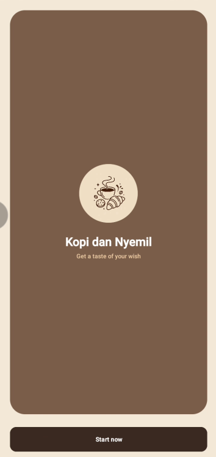
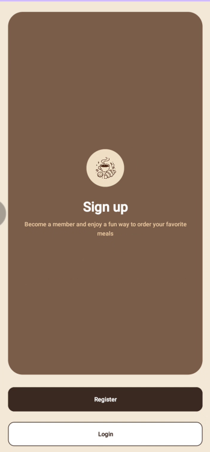
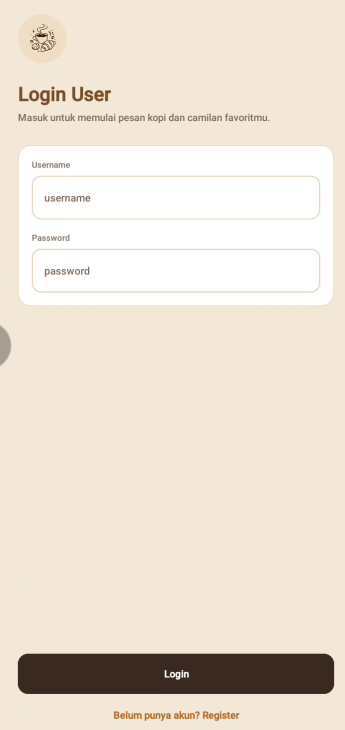
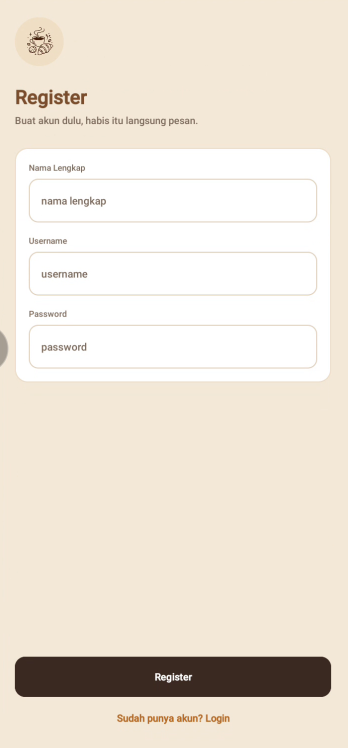
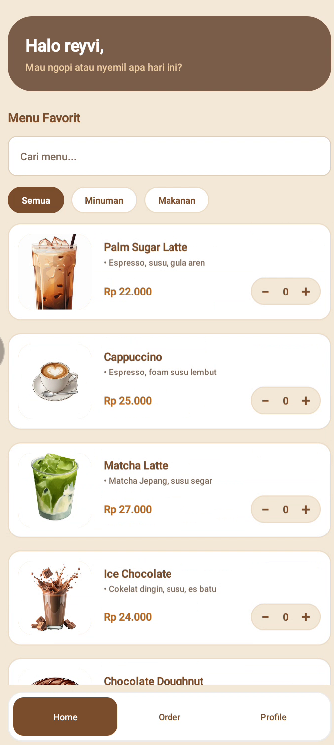
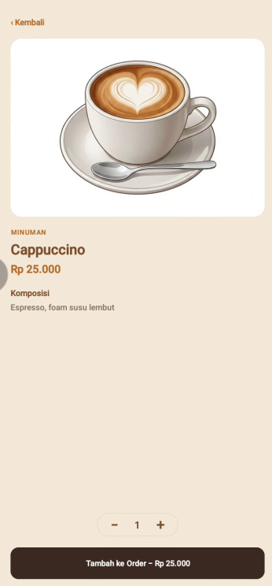
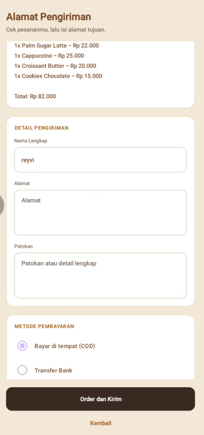
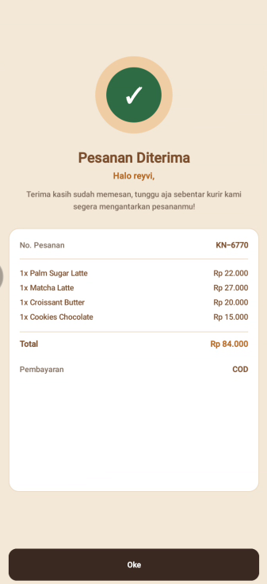
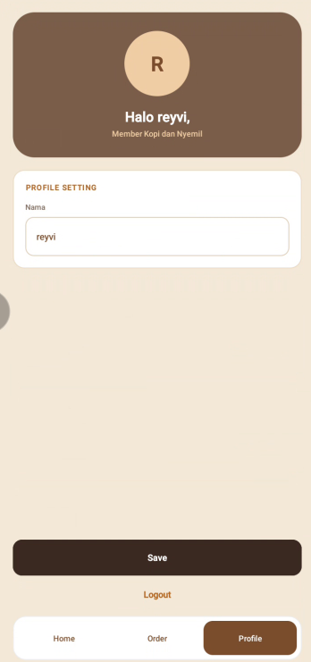

# Kopi dan Nyemil

Aplikasi mobile pemesanan kopi dan camilan berbasis Android, dibuat berdasarkan wireframe "Kopi dan Nyemil" untuk tugas mata kuliah Pemrograman Aplikasi Mobile.

Pengguna bisa mendaftar atau login, mencari dan memilih menu makanan dan minuman, mengisi alamat pengiriman, memilih metode pembayaran, lalu mendapat konfirmasi pesanan berupa struk singkat. Semua data memakai data statis (dummy), jadi aplikasi tidak membutuhkan database maupun koneksi internet.

## Fitur

- Splash / Welcome dengan animasi muncul pelan
- Sign Up dengan pilihan Register atau Login
- Register akun baru (validasi kolom kosong, password minimal 6 karakter, username tidak boleh sama)
- Login dengan username dan password
- Home berisi daftar 8 menu makanan dan minuman (RecyclerView), lengkap dengan foto, deskripsi, dan harga
- Filter menu berdasarkan kategori (Semua, Minuman, Makanan)
- Pencarian menu berdasarkan nama atau komposisi
- Tambah dan kurangi jumlah pesanan langsung dari daftar menu
- Bar total keranjang di Home (jumlah item dan total harga)
- Halaman detail menu (foto, harga, komposisi, pengatur jumlah)
- Bottom navigation (Home, Order, Profile) dengan jumlah item di tab Order
- Alamat Pengiriman berisi ringkasan pesanan, nama lengkap, alamat, patokan, dan pilihan metode pembayaran (COD, Transfer Bank, E-Wallet)
- Konfirmasi Pesanan berupa struk singkat (nomor pesanan, rincian menu, total, pembayaran, estimasi tiba)
- Profile untuk mengubah nama, serta Logout

## Teknologi yang Digunakan

- Bahasa pemrograman: Kotlin
- Tampilan: XML Layout (LinearLayout, RelativeLayout, FrameLayout, ScrollView)
- Komponen: RecyclerView dengan Adapter, Material Button, EditText dengan TextWatcher, RadioGroup, Toast
- Perpindahan halaman: Activity dan Explicit Intent (termasuk pengiriman data dengan putExtra)
- Penyimpanan data: data dummy dalam object Kotlin (tanpa database)
- IDE: Android Studio
- Minimum SDK: API 27 (Android 8.1 Oreo)

## Struktur Halaman

1. SplashActivity (Splash / Welcome)
2. SignUpActivity
3. LoginActivity
4. RegisterActivity
5. MainActivity (Home)
6. DetailActivity (Detail Menu)
7. AlamatActivity (Alamat Pengiriman)
8. KonfirmasiActivity (Konfirmasi Pesanan)
9. ProfileActivity

## Cara Menjalankan Aplikasi

1. Pastikan Android Studio sudah terpasang.
2. Clone repository ini:
   git clone https://github.com/<username>/<nama-repository>.git
3. Buka Android Studio, pilih File > Open, lalu pilih folder project yang sudah di-clone.
4. Tunggu proses Gradle Sync sampai selesai.
5. Siapkan perangkat: emulator (Device Manager) atau HP Android dengan USB debugging aktif.
6. Klik tombol Run (segitiga hijau).

## Akun Demo

Untuk mencoba login tanpa mendaftar:

- Username: demo
- Password: 123456

Akun hasil Register hanya tersimpan selama aplikasi berjalan. Jika aplikasi ditutup, akun tersebut hilang karena aplikasi tidak memakai database.

## Alur Penggunaan

Splash > Sign Up > Register atau Login > Home (cari dan pilih menu) > Order > Alamat Pengiriman > Konfirmasi Pesanan > Home

Dari Home, kartu menu juga bisa diklik untuk membuka halaman Detail Menu.

## Screenshot

Splash

Sign Up

Login

Register

Home

Detail Menu

Alamat Pengiriman

Konfirmasi Pesanan

Profile

